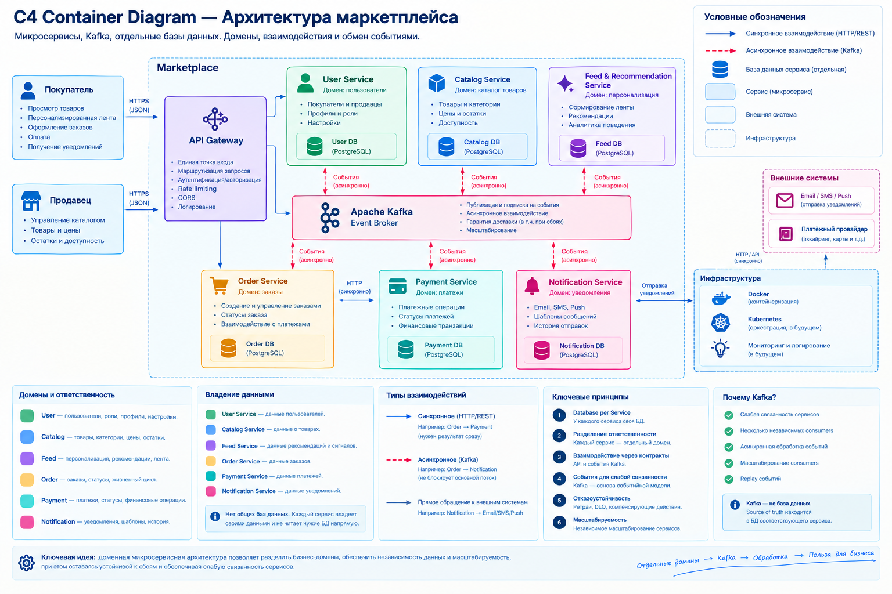

# Архитектурное проектирование системы маркетплейса

Учебный проект: **C4 Container диаграмма + доменная декомпозиция + владение данными + асинхронные события Kafka + минимальная реализация одного сервиса в Docker**.

## Структура проекта

```text
.
├── README.md
├── docker-compose.yml
├── architecture/
│   ├── marketplace-container.puml
│   ├── c4-container-color-preview.png
│   ├── c4-container-preview.png
│   ├── README.md
│   └── architecture-decisions.md
├── catalog-service/
│   ├── Dockerfile
│   ├── .dockerignore
│   ├── requirements.txt
│   └── app/
│       └── main.py
└── docs/
    └── architecture-notes.md
```

## C4 Container диаграмма

Основной источник диаграммы — [`architecture/marketplace-container.puml`](architecture/marketplace-container.puml). Это **PlantUML + C4-PlantUML**.

Для просмотра без рендера исходника используется готовое цветное изображение:



Диаграмма показывает:

- покупателей и продавцов;
- Marketplace как системную границу;
- API Gateway;
- User Service;
- Catalog Service;
- Feed & Recommendation Service;
- Order Service;
- Payment Service;
- Notification Service;
- Apache Kafka;
- отдельную БД каждого доменного сервиса;
- внешний платёжный провайдер;
- внешние каналы Email / SMS / Push;
- синхронные HTTP/REST-взаимодействия;
- асинхронные события Kafka;
- ownership данных и принцип Database per Service.

## 1. Финальная архитектура

Выбран **вариант B — доменно-ориентированная микросервисная архитектура**.

Клиенты работают через единую точку входа — API Gateway. Gateway маршрутизирует запросы к соответствующим доменным сервисам. Каждый доменный сервис отвечает только за свою область и владеет собственной базой данных.

Основные сервисы:

| Сервис | Домен | Основная ответственность | БД |
|---|---|---|---|
| **User Service** | User | Покупатели, продавцы, профили, роли, настройки | User DB |
| **Catalog Service** | Catalog | Товары, категории, цены, остатки, доступность | Catalog DB |
| **Feed & Recommendation Service** | Feed | Сигналы пользователя, рекомендации, персонализированная выдача | Feed DB |
| **Order Service** | Order | Создание заказа, позиции, статусы, жизненный цикл | Order DB |
| **Payment Service** | Payment | Платежи, попытки, статусы и финансовые операции | Payment DB |
| **Notification Service** | Notification | Шаблоны, каналы доставки, история уведомлений | Notification DB |

Дополнительно используется **Apache Kafka** как инфраструктурный Event Broker.

## 2. Домены и ответственность

### User

Отвечает за идентичность пользователей маркетплейса:

- покупатели и продавцы;
- профили;
- роли;
- настройки пользователя.

### Catalog

Отвечает за товарный каталог:

- товары;
- категории;
- цены;
- остатки;
- доступность.

### Feed & Recommendation

Отвечает за персонализацию:

- пользовательские сигналы;
- профиль интересов;
- подбор кандидатов;
- ranking;
- персонализированную выдачу.

### Order

Отвечает за заказы:

- создание заказа;
- позиции заказа;
- статусы;
- жизненный цикл заказа;
- взаимодействие с оплатой.

### Payment

Отвечает за финансовую часть:

- платёжные операции;
- попытки платежа;
- статусы;
- финансовые транзакции;
- интеграцию с внешним платёжным провайдером.

### Notification

Отвечает за доставку уведомлений:

- шаблоны;
- каналы Email / SMS / Push;
- история отправок;
- интеграции с внешними провайдерами.

## 3. Распределение доменов по сервисам

Домены разделены по бизнес-ответственности, данным и жизненным циклам.

Такое разбиение позволяет:

- менять внутреннюю реализацию сервиса без изменения остальных доменов;
- масштабировать сервисы независимо;
- локализовать ошибки;
- явно определить владельца каждой категории данных;
- отделить критический checkout-путь от фоновых сценариев.

API Gateway не является доменным сервисом: это инфраструктурный контейнер, который маршрутизирует клиентские запросы и не владеет бизнес-данными.

Kafka также не является доменным сервисом: это инфраструктурный транспорт и журнал событий.

## 4. Границы владения данными

Используется принцип **Database per Service**.

| Сервис | Владеющие данные |
|---|---|
| User Service | users, profiles, roles, settings |
| Catalog Service | products, categories, prices, stock |
| Feed Service | signals, interests, recommendation state |
| Order Service | orders, order items, order status |
| Payment Service | payments, payment attempts, payment status, transactions |
| Notification Service | templates, delivery history |

### Почему нет shared database

Если несколько сервисов напрямую работают с одной БД, структура этой БД превращается в скрытый общий контракт. Изменение схемы одним доменом начинает влиять на остальные сервисы.

Поэтому сервисы не читают чужие БД напрямую. Если нужны чужие данные, используются:

- API владельца данных;
- доменные события через Kafka.

Например, `Order Service` не выполняет SQL-запросы в `Catalog DB`. Он обращается к `Catalog Service` или получает необходимые данные через события.

Это сохраняет инкапсуляцию данных и позволяет независимо изменять внутреннее хранение.

## 5. Взаимодействия: синхронные и асинхронные

### Синхронные взаимодействия

Используются там, где вызывающей стороне нужен непосредственный результат.

- Покупатель → API Gateway — HTTPS / JSON;
- Продавец → API Gateway — HTTPS / JSON;
- API Gateway → доменные сервисы — HTTP / REST;
- Order Service → Catalog Service — HTTP / REST;
- **Order Service → Payment Service — HTTP / REST**;
- Payment Service → внешний платёжный провайдер — HTTPS / API;
- Notification Service → внешний провайдер уведомлений — HTTPS / API.

### Асинхронные взаимодействия

Используются для фоновых сценариев и реакций на изменения состояния:

- User Service → Kafka: `UserBehaviorRecorded`;
- Catalog Service → Kafka: `CatalogChanged`;
- Order Service → Kafka: `OrderCreated`, `OrderStatusChanged`;
- Payment Service → Kafka: `PaymentStatusChanged`;
- Kafka → Feed Service: пользовательские сигналы и изменения каталога;
- Kafka → Notification Service: статусы заказа и платежа.

### Почему Order → Payment синхронно

В checkout пользователь ожидает результат инициации платежа. Поэтому Order Service вызывает Payment Service напрямую и получает ответ в рамках текущего сценария.

Полностью асинхронный вариант тоже возможен, но тогда подтверждение оплаты появляется позже и система становится eventually consistent в этой части процесса.

### Почему Notification асинхронно

Отправка email, SMS или push не является обязательным шагом самого checkout. Если Notification Service временно недоступен, заказ не должен из-за этого переставать создаваться или менять статус.

## 6. Персонализированная лента

Персонализация отделена в Feed Service, потому что она имеет другой профиль нагрузки и может включать вычислительно более тяжёлый ranking.

Базовый вариант:

```text
Пользовательские сигналы
        ↓
Профиль интересов
        ↓
Выбор кандидатов
        ↓
Rule-based ranking
        ↓
Персональная выдача
```

Источниками сигналов могут быть:

- просмотры;
- клики;
- добавления в корзину;
- покупки.

На ранней стадии достаточно rule-based подхода. В дальнейшем ranking может быть заменён или дополнен ML-моделью без изменения границ User, Catalog, Order и Payment.

Feed Service не должен блокировать критический checkout-путь.

## 7. Основной поток оформления заказа

```text
Покупатель
    ↓ HTTPS
API Gateway
    ↓ HTTP
Order Service
    ↓ HTTP / sync
Payment Service
    ↓
Платёжный провайдер
    ↓
PaymentStatusChanged
    ↓ async
Kafka
    ├──→ Notification Service
    └──→ Feed / другие consumers
```

Логика выбора протоколов здесь следующая:

1. пользовательский запрос требует немедленного ответа;
2. инициация платежа является частью текущего checkout и выполняется синхронно;
3. уведомление является вторичным эффектом и поэтому отправляется асинхронно;
4. другие потребители событий могут подключаться к Kafka независимо от Order и Payment.

## 8. Kafka

Kafka используется как Event Broker.

### Зачем Kafka

- слабая связанность между producer и consumers;
- несколько независимых потребителей одного события;
- асинхронная обработка;
- независимое масштабирование consumers;
- возможность replay событий;
- возможность построить event-driven взаимодействия без цепочки синхронных вызовов.

Kafka не является source of truth для доменных данных. Например, source of truth заказа — `Order DB`, а source of truth платежа — `Payment DB`.

## 9. Отказы и согласованность

Архитектура предполагает несколько стандартных механизмов распределённых систем.

### Eventual consistency

После асинхронного события разные сервисы могут кратковременно видеть разные состояния. Система приходит к согласованному состоянию после обработки события.

### Idempotency

Consumers должны быть идемпотентными: повторная доставка одного события не должна приводить к повторному бизнес-эффекту.

Например, повторное получение `PaymentStatusChanged` не должно дважды отправить одно и то же уведомление.

### Retry и DLQ

Для временных ошибок возможны повторные попытки обработки. После исчерпания допустимого числа retry сообщение может быть отправлено в dead-letter queue для отдельной обработки.

### Saga

Если одна бизнес-операция затрагивает несколько сервисов и состоит из нескольких локальных транзакций, можно использовать Saga с компенсирующими действиями вместо общей распределённой транзакции.

Эти механизмы относятся к возможному production-развитию и не требуются в минимальной реализации данного задания.

## 10. Альтернативные варианты архитектуры

### Вариант A — модульный монолит

```text
Marketplace Backend
├── User
├── Catalog
├── Feed
├── Order
├── Payment
└── Notification

        ↓
    одна БД
```

Все домены находятся внутри одного backend-приложения и используют общую БД.

**Преимущества:**

- проще разработка;
- проще деплой;
- проще транзакции;
- меньше инфраструктуры;
- проще локальная отладка.

**Недостатки:**

- общее масштабирование;
- слабее изоляция доменов;
- сложнее независимые релизы;
- при росте проекта границы модулей могут постепенно размываться.

### Вариант B — доменные микросервисы

```text
User Service        → User DB
Catalog Service     → Catalog DB
Feed Service        → Feed DB
Order Service       → Order DB
Payment Service     → Payment DB
Notification Service→ Notification DB

                    ↕
                  Kafka
```

Каждый домен вынесен в самостоятельный сервис с собственной БД.

**Преимущества:**

- чёткий ownership;
- независимое масштабирование;
- независимые релизы;
- изоляция данных;
- естественная поддержка асинхронных сценариев.

**Недостатки:**

- сетевые взаимодействия;
- distributed failures;
- eventual consistency;
- сложнее observability;
- отдельная инфраструктура Kafka и сервисов.

### Вариант C — укрупнённые сервисы по бизнес-потокам

```text
Marketplace Core
    ├── User
    └── Catalog

Checkout
    ├── Order
    └── Payment

Engagement
    ├── Feed
    └── Notification
```

**Преимущества:**

- меньше сервисов;
- меньше сетевых вызовов;
- эксплуатация проще, чем в варианте B;
- при этом сохраняется часть доменной изоляции.

**Недостатки:**

- границы сервисов крупнее;
- хуже независимое масштабирование отдельных доменов;
- сложнее развивать сильно растущие части внутри одного укрупнённого сервиса.

## 11. Trade-off и финальный выбор

Финально выбран **вариант B — доменные микросервисы**.

Это не означает, что микросервисы универсально лучше модульного монолита. Модульный монолит проще и часто рациональнее на небольшом проекте.

Для данного кейса вариант B выбран по следующим причинам:

1. Требования естественно разделяются на независимые домены: пользователи, каталог, персонализация, заказы, платежи и уведомления.
2. Для каждого домена можно явно определить владельца данных.
3. Разные домены имеют разные профили нагрузки и жизненные циклы.
4. Feed и Notification можно отделить от критического checkout-пути.
5. Kafka позволяет связать фоновые сценарии событиями без жёсткой зависимости сервисов друг от друга.
6. В архитектуре отсутствует shared database, что делает границы ответственности технически явными.

Главный trade-off:

> **Независимость доменов, данных и масштабирования достигается ценой сложности распределённой системы.**

## 12. Практическая реализация

В рамках практической части реализован один сервис — **Catalog Service**.

Реализация намеренно минимальна и не содержит бизнес-логики.

Сервис:

- написан на FastAPI;
- собирается в Docker;
- имеет endpoint `GET /health`;
- возвращает `200 OK`.

Для health-check не требуется база данных, Kafka, авторизация, CRUD или другие бизнес-компоненты.

### Запуск

```bash
docker compose up --build
```

### Проверка

```bash
curl -i http://localhost:8000/health
```

Ожидаемый ответ:

```text
HTTP/1.1 200 OK
```

и тело:

```json
{"status":"ok"}
```

## 13. Соответствие требованиям задания

| Требование | Реализация |
|---|---|
| C4 Container | `architecture/marketplace-container.puml` + PNG-превью |
| Маркетплейс и основные части | System boundary + доменные сервисы на диаграмме |
| Один сервис | `catalog-service` |
| Docker | `catalog-service/Dockerfile` + `docker-compose.yml` |
| Health-check | `GET /health` |
| 200 OK | Да |
| Инструкция запуска | Этот README |
| Домены и ответственность | разделы 2–3 |
| Распределение доменов по сервисам | раздел 3 |
| Ownership данных | раздел 4 |
| Нет shared DB | раздел 4 + C4 |
| Sync/async взаимодействия | раздел 5 + C4 |
| ≥2 альтернативы | раздел 10 |
| Trade-off'ы | раздел 10 |
| Финальный выбор и обоснование | раздел 11 |
